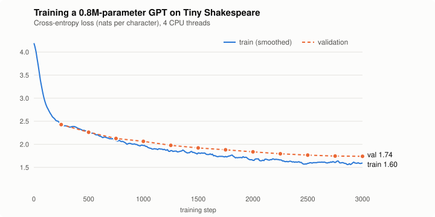

# rustgpt

**A GPT language model built from scratch in pure Rust. No dependencies, no autograd library, no BLAS — every gradient is derived and written by hand.**


`Cargo.toml` has an empty `[dependencies]` section. The tokenizer, transformer, backpropagation, AdamW optimizer, multithreading, checkpoint format, RNG and CLI are all implemented here in about 1,400 lines of Rust (tests included). It trains a character-level GPT on Shakespeare **on a laptop CPU in about 13 minutes**, and it can show you what its attention heads are looking at.



## What it writes

After 3,000 steps (13 minutes on 4 CPU threads), prompted with `ROMEO:`:

```
ROMEO:
Hark, leady holy heads his war.

SICINIUS:
This but of the coldiere of your a live my offfarce?

ISABELLA:
Edike in this lect that own to this no quert?

AUCHINGE:
The come to of the foult, must so half stay true,
And but appprokedideness the sitters for caid town,
And him thought a be a thought advengess,
Then in O be mine and first me and against.

ANGELO:
I gernew one an the old remouce: thusb
```

That's a 0.8M-parameter model that sees 64 characters at a time and started from random noise. It learns the play format, speaker names, line breaks, punctuation, and English-shaped words. Some of them are even real.

## Quick start

```bash
git clone https://github.com/isaac2018brenner/rustgpt && cd rustgpt

# AVX2/AVX-512 make a big difference, so build for your CPU
export RUSTFLAGS="-C target-cpu=native"

cargo run --release -- train                       # ~13 min on 4 cores, writes model.bin
cargo run --release -- generate --prompt "ROMEO:" --tokens 500
cargo run --release -- attn --text "KING RICHARD:"  # look inside the model
```

Train on any UTF-8 text file with `--data path/to/file.txt`. Run `cargo run --release -- help` for every flag (model size, context length, learning rate, and more).

## Looking inside: attention maps

`rustgpt attn` runs one forward pass and draws every attention head in a layer, plus the model's next-character prediction. In a terminal it renders as a grayscale heatmap; piped output uses ASCII. Each row is a query position, and each column is a character it can attend to; the triangle shape is the causal mask.

```
Attention in layer 3 (rows: query position, columns: key position)

head 3   KING·RICHARD:⏎What·say
     K @
     I #*
     N #*:
     G *+-=
     · =====
     R -=*-::
     I :-::.=#
     C -=-=..+:
     H -=--.:=:=
     A ..   ..+# 
     R ::.. .:+*..
     D :. . .:+*.:-
     : .:-.:.::-:+:-
     ⏎   .   ....:..@
     W   . .....::.:% 
     h ....-.:-.::::-:+
     a        .      :%-
     t        .      :+.#
     ·     .... ....:.*-:+
     s     . .. ....+....*:
     a      .    . ...:..::%
     y               .-.: :#=
Next character after "KING RICHARD:\nWhat say":
  ' '  56.0% ██████████████████████
  ','  25.2% ██████████
  's'   4.8% ██
  '\''   2.1% █
  '!'   1.8% █
```

This is head 3 of the last layer (the command prints every head). Its brightest cell in almost every row sits on or just left of the diagonal, so it's a local head that mostly attends to the last one or two characters. That's the information you need to finish a word. Other heads in the same layer spread their attention further back. Given "What say", the model predicts a space or a comma next, which is plausible English.

## How it works

```
tokens ─► token embedding + position embedding
            │
            ▼
   ┌──── × 4 transformer blocks ─────────────────────┐
   │  x = x + Attention(LayerNorm(x))   4 heads, causal │
   │  x = x + MLP(LayerNorm(x))         C → 4C → C, GELU│
   └──────────────────────────────────────────────────┘
            │
            ▼
       LayerNorm ─► logits (weights tied to token embedding) ─► softmax
```

This is the GPT-2 architecture (pre-norm, learned positions, tied embeddings, GELU), scaled down.

| File | What's in it |
|---|---|
| [`src/ops.rs`](src/ops.rs) | Forward **and backward** for matmul, LayerNorm, causal multi-head attention, GELU, residuals, embeddings and softmax |
| [`src/model.rs`](src/model.rs) | Parameter layout, GPT-2 init, the full forward pass, backprop through the residual stream, sampling, and tests |
| [`src/optim.rs`](src/optim.rs) | AdamW with decoupled weight decay |
| [`src/parallel.rs`](src/parallel.rs) | A ~30-line work splitter on `std::thread::scope` |
| [`src/data.rs`](src/data.rs) | Character tokenizer and random batch sampling |
| [`src/checkpoint.rs`](src/checkpoint.rs) | A self-describing binary checkpoint format |
| [`src/main.rs`](src/main.rs) | CLI: `train`, `generate`, `attn`, `info` |

### Some details

- **Manual backprop.** Each op has a hand-derived backward pass, including softmax inside attention (`dpre = a ⊙ (datt − Σ a·datt)`) and the LayerNorm Jacobian. The residual gradient flows down a single buffer that each block adds into, mirroring the forward pass.
- **Verified by finite differences.** The test suite perturbs weights in all 16 parameter tensors and checks that the analytic gradients match `(L(θ+ε) − L(θ−ε)) / 2ε`. Breaking any backward pass makes `cargo test` fail.
- **Fast enough to be fun.** Matmuls are cache-blocked, with 8-lane accumulators so LLVM emits SIMD, and split across threads with disjoint `&mut` chunks, so the parallelism needs no `unsafe` code or locks.
- **Training recipe.** AdamW (β = 0.9, 0.95), linear warmup into cosine decay, global gradient-norm clipping, and weight decay on matrices only, following nanoGPT/GPT-2.
- **Sampling.** Temperature and top-k, with a sliding context window for generating past the block size.

## Tests

```bash
cargo test --release
```

- `gradients_match_finite_differences`: checks every backward pass numerically.
- `attention_is_causal`: changing future tokens must not change earlier predictions.
- `can_overfit_a_batch`: the full training loop can memorize a batch, confirming the pieces fit together.

CI runs `rustfmt`, `clippy -D warnings`, and the tests on every push.

## Results

Default configuration (`rustgpt train`), measured on a 4-thread cloud VM:

| | |
|---|---|
| Parameters | 0.81M (4 layers, 4 heads, 128 dim, 64-char context) |
| Training | 3,000 steps × 16 × 64 = 3.1M characters seen |
| Wall clock | 13.1 min, ~245 ms/step, ~4,000 tokens/s |
| Loss at step 1 | 4.19 (≈ ln 65, i.e. random guessing over 65 characters) |
| Final validation loss | **1.7408** nats/char |

The loss curve was generated from the training log with [`scripts/plot_loss.py`](scripts/plot_loss.py) (raw log: [`assets/train.log`](assets/train.log)). A bigger model (`--layers 6 --embd 192 --block 128`) trained for longer gets noticeably better, if you have the patience.

The trained checkpoint is included as `assets/shakespeare.bin` (3 MB), so you can try generation without training:

```bash
cargo run --release -- generate --model assets/shakespeare.bin --prompt "JULIET:"
```

## Ideas for extending it

- A BPE tokenizer in place of characters
- KV caching to make generation O(T) per token instead of O(T²)
- Rotary position embeddings, RMSNorm, SwiGLU (Llama-style blocks)
- Loading the real GPT-2 124M weights
- A WebAssembly build that runs in the browser

## Acknowledgements

The architecture and training recipe follow GPT-2, and the code structure was inspired by Andrej Karpathy's [llm.c](https://github.com/karpathy/llm.c) and [nanoGPT](https://github.com/karpathy/nanoGPT). The dataset is [Tiny Shakespeare](https://github.com/karpathy/char-rnn).

## License

MIT
